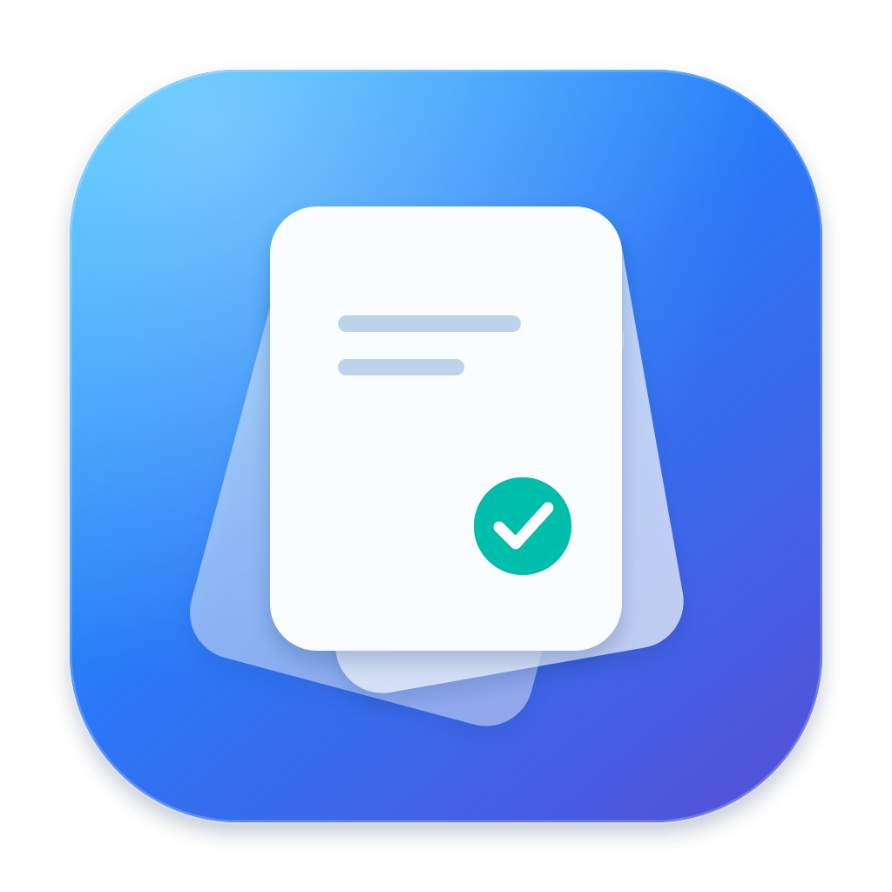

# Unpile — review your Downloads one file at a time



[Русский](README.ru.md)

Keep what you need. Mark the rest for Trash, review the candidate list, and confirm the move. Unpile is a native macOS app built with SwiftUI and AppKit.

**Beta 0.7.0.** Free, ad hoc signed, and not notarized. See [installation guidance](docs/INSTALL.txt) and the compatibility limits below.

**[Download beta for macOS](https://github.com/DoonyFreeman/Unpile/releases/download/v0.7.0-beta.1/Unpile-0.7.0-universal.dmg)** · Universal arm64/x86_64 · about 3 MB

The first GitHub release is pending approval; this download link becomes available when `v0.7.0-beta.1` is published. The MIT license is prepared for publication review.

## Current features

- Choose one local folder with the system picker; access survives restarts.
- Review files in sessions of 20, 50, or 100, with largest/oldest/name ordering.
- Preview images, PDFs, and supported media with system Quick Look.
- Keep, Later, or Mark for Trash using buttons, drag, or keyboard shortcuts.
- Two-finger horizontal swipes over the card: left marks a candidate, right keeps the file. Decisions occur on release; short/cancelled gestures and momentum cannot choose another card.
- A layered card with colored gesture feedback and a fixed decision dock that stays visible in compact windows.
- Resume decisions, candidates, and Undo after closing the app. Reconsider kept files at any time.
- Switch between English, Russian, and the system language without resetting the review.
- Confirm the candidate list before moving anything. Unpile uses system Trash and never empties it.
- Original app icon, Universal app packaging, and a drag-to-Applications DMG.
- Stay local: no accounts, servers, analytics, or file uploads.

A changed file gets a new decision. Keep applies to an unchanged version; Later returns in the next review. New downloads, directories, links, hidden files, unfinished downloads, and cloud items are filtered by the current policy. Including recent files is optional.

## How it works

1. Choose a folder, or try the demo first.
2. Swipe left to mark a candidate, right to keep it, or choose Later. Undo changes a decision before transfer.
3. Review the candidate list and confirm the move to system Trash.

Moving files to Trash does not necessarily free disk space immediately. Unpile never empties Trash.

## Build locally

Use Apple Command Line Tools with Swift 6+. Full Xcode and a paid Apple Developer Program membership are not required for this local build.

```sh
swift run UnpileChecks
bash scripts/build-app.sh
```

Open `build/Unpile-0.7.0.app` and choose a folder or try the synthetic demo. The script packages localization resources and adds an ad hoc signature. GUI testing covers Apple Silicon on macOS 27. The macOS 14 fallback and physical Intel device support still need validation.

## Package a local DMG

```sh
bash scripts/package-dmg.sh --universal
```

The Universal image is written to `build/releases/Unpile-0.7.0-universal.dmg`, with a SHA-256 file and source manifest. Python 3.10+ is required for packaging; two hash-pinned build tools are installed in an isolated environment and never included in the app. This is a local beta asset, not a published download link.

[Installation guidance](docs/INSTALL.txt) · [Release candidate review](docs/RELEASE_CANDIDATE.md) · [Publication package](docs/PUBLICATION_PREVIEW.md)

## Keyboard

| Key | Action |
| --- | --- |
| ← / → / ↓ | Mark for Trash / Keep / Later |
| Space | Open preview |
| Cmd+Z | Undo a decision before transfer |
| Cmd+Enter | Review candidates |
| Cmd+O / Cmd+, | Choose folder / settings |
| Escape | Close preview or sheet |

Moving files is a separate confirmation action. Decisions cannot change underneath an open preview, settings sheet, picker, confirmation, or error dialog. Tab navigation follows the macOS Keyboard Navigation setting.

Keep the pointer over the visible card for trackpad gestures. Vertical scrolling still scrolls the review. Natural Scrolling is normalized to finger direction. See [gesture behavior and hardware QA](docs/GESTURES_AND_DESIGN.md).

## Beta limits and verification

27 checks cover session behavior, file policy, stale versions and links, journal failures, interrupted transfers, saved state, localization, a synthetic 1000-file inventory, and swipe sequences. Native UI QA uses a separate app identity and synthetic fixtures. The user confirmed both two-finger swipe directions on a physical trackpad in the final 0.6.0 demo; gesture code is unchanged in 0.7.0. The extended gesture walkthrough, full spoken VoiceOver walkthrough, older macOS, Intel, and a wider media-codec matrix remain release checks.

Restore files through Finder’s Trash. Metadata checks and file coordination do not eliminate every race with other processes. Version 0.7.0 uses the permanent app identity. Earlier local betas use separate containers; their sessions are not automatically imported. Keeping the identity stable does not yet establish ad hoc update compatibility.

## Contributing and license

See [CONTRIBUTING.md](CONTRIBUTING.md), [SECURITY.md](SECURITY.md), [CODE_OF_CONDUCT.md](CODE_OF_CONDUCT.md), and [CHANGELOG.md](CHANGELOG.md). The [MIT license](LICENSE) and reporting channel must be confirmed in the publication review.

## Project documents

- [Progress and verification](docs/PROGRESS.md)
- [Product plan](docs/PRODUCT_PLAN.md)
- [UI and UX](docs/UX_SPEC.md)
- [Implementation plan](docs/IMPLEMENTATION_PLAN.md)
- [Local data and retention](docs/LOCAL_DATA.md)
- [Localization, accessibility, and preview](docs/LOCALIZATION_AND_ACCESSIBILITY.md)
- [Release and community plan](docs/RELEASE_AND_GROWTH.md)

These plans include future v1 work. GitHub publication will follow review of a specific revision and destination.
