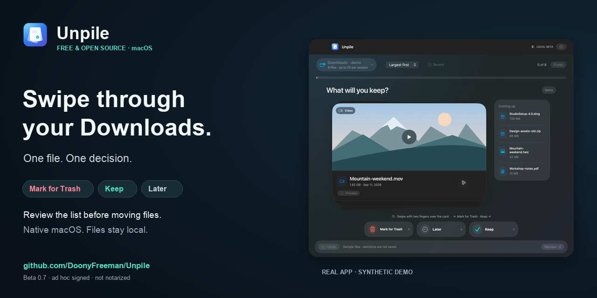
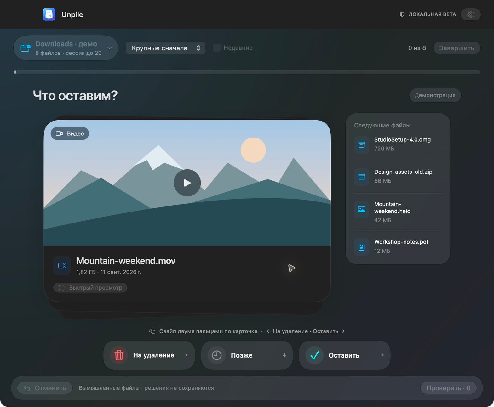
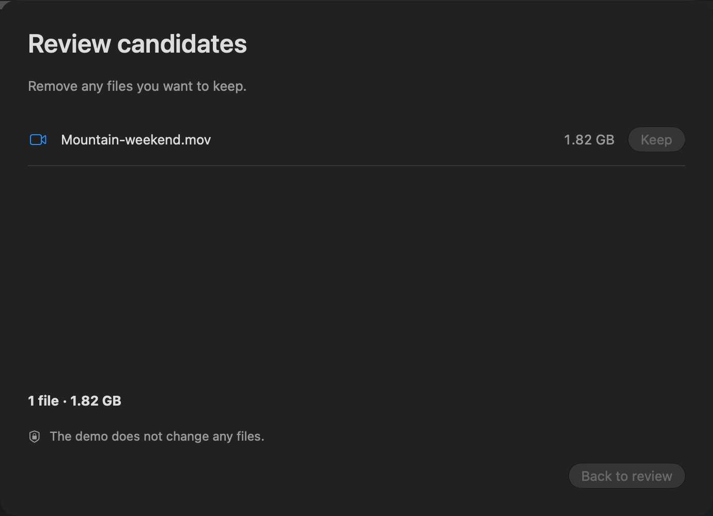

# Unpile — приложение для разбора файлов на macOS

**Beta 0.7.0.** Нативное бесплатное приложение с ad hoc подписью, без notarization. [Инструкция установки](docs/INSTALL.txt).

**[Скачать beta для macOS](https://github.com/DoonyFreeman/Unpile/releases/download/v0.7.0-beta.1/Unpile-0.7.0-universal.dmg)** · Universal arm64/x86_64 · около 3 МБ

[](docs/assets/promo/walkthrough.gif)

**[Демо за 20 секунд](docs/assets/promo/walkthrough.gif)** · [MP4](docs/assets/promo/walkthrough.mp4)

Последовательность реальных экранов показывает решения, отмену и отдельную проверку списка. Файлы и размеры вымышленные; переносов не было. Обложка статичная, анимация открывается по ссылке.

<details>
<summary>Посмотреть скриншоты приложения</summary>

**Карточка и решения на русском**



**Проверка кандидатов перед переносом**



</details>

Идея: разбирать Downloads короткими сессиями, просматривать файлы по одному и выбирать «Оставить», «На удаление» или «Позже». Отмеченные файлы попадают в системную Корзину только после проверки списка и подтверждения.

| Документ | Что внутри |
| --- | --- |
| [Продуктовый план](docs/PRODUCT_PLAN.md) | Позиционирование, аудитория, сценарии, MVP, безопасность, критерии успеха |
| [UI и UX](docs/UX_SPEC.md) | Экраны, карточка файла, жесты, клавиатура, состояния и тексты |
| [План реализации](docs/IMPLEMENTATION_PLAN.md) | Нативный стек, архитектура, данные, этапы, проверки и критерии готовности |
| [Релиз и развитие open source](docs/RELEASE_AND_GROWTH.md) | Установка, подпись, GitHub Releases, документация, продвижение и поддержка |

Основная гипотеза: короткий разбор крупных файлов с понятным превью помогает принять решения быстрее, чем обычный список в Finder. Это нужно проверить на пользователях; красивые свайпы сами по себе не подтверждают пользу.

Все примеры интерфейса и демонстрационные данные должны быть синтетическими. Продуктовые планы описывают целевую v1.0; реализованное поведение перечислено ниже и в документе прогресса.

## Локальный запуск

Нужны Apple Command Line Tools с Swift 6+. Полный Xcode и Apple Developer Program для этой сборки не требуются. Liquid Glass использует SDK/macOS 26+; для старых систем предусмотрен fallback, но сейчас проверена только macOS 27 на Apple Silicon.

```sh
swift run UnpileChecks
bash scripts/build-app.sh
```

Приложение появится в `build/Unpile-0.7.0.app`. Откройте его через Finder и выберите папку либо демонстрацию. Сборка с бесплатной ad hoc подписью предназначена для локальной проверки.

Что уже работает: выбор одной локальной папки, сохранение доступа после перезапуска, сортировка, сессии по 20/50/100 файлов, превью, сохранение решений и Undo после перезапуска, пересмотр оставленных, English/Русский с переключением без перезапуска, полноценный системный Quick Look, проверка списка, подтверждённый перенос в системную Корзину, поэлементный результат и журнал незавершённых операций. Демо не изменяет файлы.

В beta 0.6 добавлены горизонтальные свайпы двумя пальцами над карточкой: влево — отметить кандидата, вправо — оставить. Решение принимается при отпускании; короткие/отменённые движения и инерция не выбирают следующий файл. Вертикальная прокрутка сохранена. Новый экран использует стопку карточек, цветную обратную связь и нижнюю панель решений, видимую в компактном окне. [Поведение и проверка жестов](docs/GESTURES_AND_DESIGN.md).

Решения привязаны к версии файла и выбранной папке. «Оставить» пропускается в следующих разборах, «Позже» возвращается при новом разборе. Изменённый файл требует нового решения. Кандидаты после перезапуска ждут проверки списка; автоматического переноса нет. Параметры сессии меняются до первого решения. Локальная память очищается через настройки или отключение папки; подробнее — [локальные данные](docs/LOCAL_DATA.md).

**Ограничения beta:** полный проход с озвучиванием VoiceOver и расширенный пользовательский пилот ещё нужны перед v1. Восстановление файлов — через системную Корзину. Приложение не очищает её и не использует permanent delete. GUI на физическом Intel Mac и минимальная macOS пока не проверены.

[GitHub Actions](https://github.com/DoonyFreeman/Unpile/actions/runs/38090790265): 27 проверок, сборка и проверка подписи/ресурсов прошли на `macos-26` и `macos-26-intel`. Эти автоматические задания не заменяют проверку интерфейса на устройствах.

[Текущий прогресс и результаты проверки](docs/PROGRESS.md). [Локализация, доступность и просмотр](docs/LOCALIZATION_AND_ACCESSIBILITY.md). Раздельные идентичности локальных beta сохраняют старые открытые сборки; версия 0.7 использует постоянный ID `io.github.doonyfreeman.unpile`, но не импортирует сессии временных beta 0.2–0.6. Совместимость будущих ad hoc обновлений ещё требует проверки.

Оформление в духе macOS 27 / Liquid Glass, основной вариант «Обзор». Первый GitHub-релиз выпущен без обязательной покупки Apple Developer Program; Developer ID и нотарификация — возможное последующее улучшение установки.

## Установочный образ

`bash scripts/package-dmg.sh --universal` создаёт `build/releases/Unpile-0.7.0-universal.dmg`, SHA-256 и source manifest. Требуется Python 3.10+; packaging-tools изолированы и не поставляются внутри приложения. Готовая beta доступна по ссылке скачивания выше. [Лицензия MIT](LICENSE).

[Инструкция установки](docs/INSTALL.txt) · [Кандидат релиза](docs/RELEASE_CANDIDATE.md) · [Пакет публикации](docs/PUBLICATION_PREVIEW.md) · [Участие](CONTRIBUTING.md) · [Безопасность](SECURITY.md).

Если Unpile оказался полезен, звезда в [GitHub](https://github.com/DoonyFreeman/Unpile) поможет другим найти проект. Особенно полезна обратная связь об установке и первом разборе.
